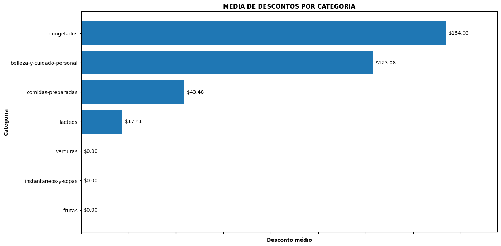
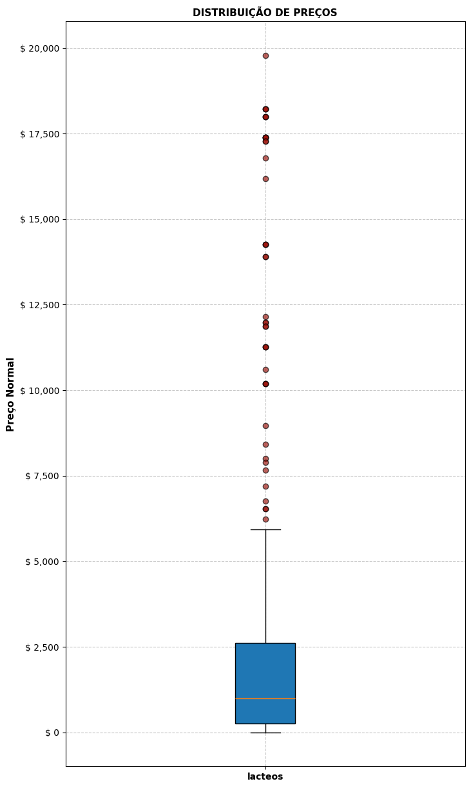
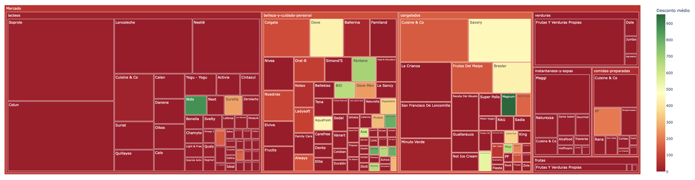

## Análise estatística para uma rede de supermercados
Projeto desenvolvido para EBAC.

### Objetivo
Analisar o comportamento dos preços e descontos por categoria, identificando diferenças entre média e mediana, categorias com maior dispersão e possíveis valores extremos.

### Base de Dados e Análise
A base de dados é composta por 1.107 produtos distribuídos em 7 categorias (Beleza e cuidados pessoais; Comidas preparadas; Congelados; Frutas; Instantâneos e sopas; Lácteos e Verduras). 
Estruturada em 7 colunas, as variáveis utilizadas nesta análise foram:
- Categoria
- Preço_Normal
- Marca
- Desconto

Etapas da análise:

1. Leitura e validação da base de dados
2. Cálculo de média e mediana dos preços sem desconto por categoria
3. Cálculo do desvio padrão por categoria
4. Plotagem do gráfico boxplot para análise de distribuição e verificação de outliers
5. Plotagem do gráfico de barras para comparação de desconto médio por categoria
6. Plotagem do gráfico treemap interativo do desconto médio por categoria e marca

Tecnologias utilizadas: 
Python | Pandas | Matplotlib | Plotly | Google Colab

### Visualização dos Gráficos

##### Gráfico de Barras - Média de preço por categoria

  

 

##### Gráfico Boxplot - Distribuição de preço para categoria com maior desvio padrão

  

  

##### Gráfico Treemap - Desconto médio por categoria e marca

  
  

### Análise dos resultados
A maior parte das categorias apresenta médias superiores às medianas, o que sugere uma assimetria positiva provocada por produtos de alto valor. Destaca-se a categoria de lácteos, cuja média excede a mediana em 141% (R$ 2.385,22 e R$ 989,00, respectivamente), evidenciando a presença de produtos com preços substancialmente superiores aos demais. Em contrapartida, categorias como comidas preparadas e verduras demonstram maior proximidade entre os valores de média e mediana, o que indica uma distribuição de preços mais equilibrada e homogênea.

Nota-se que as categorias com maior desvio padrão também registram médias superiores às medianas. Nesse grupo, a categoria de lácteos se sobressai com um desvio padrão notavelmente superior à sua média (3.925,82 e 2.385,22), refletindo uma ampla dispersão e alta variabilidade entre os itens de menor e maior custo.

Essa distribuição fica clara ao observar o boxplot, a caixa concentra-se na parte inferior do gráfico, mostrando que a grande maioria dos produtos possui preços baixos. A linha da mediana dentro da caixa está descentralizada, reforçando que os dados são assimétricos e que metade dos produtos possuem valores mais baixos. Além disso, podemos observar uma grande quantidade de pontos fora do limite superior (valores atípicos de preços) que se estendem por uma ampla faixa do eixo, justificando o valor elevado do desvio padrão.
